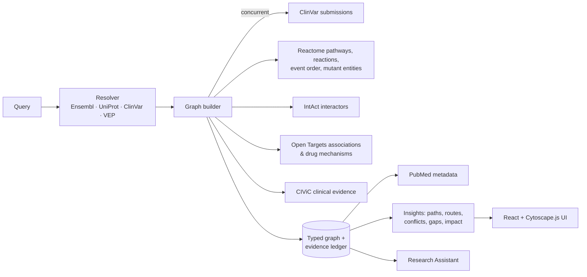

<div align="center">

# 🧬 PathwayGPS

### From mutation to mechanism.

**An evidence-backed navigation layer that follows a genetic variant through its gene, protein, Reactome pathways and downstream biology, with the source record and literature behind every relationship.**

[](https://redrogod69.github.io/PathwayGPS/)
[](https://github.com/redrogod69/PathwayGPS/actions/workflows/pages.yml)


[**Try the demo →**](https://redrogod69.github.io/PathwayGPS/?q=EGFR%20L858R) · [Run locally](#run-locally) · [How it works](#how-it-works) · [Scientific integrity](#scientific-integrity)

*MedVision ’26 · BioNav · B.Tech Biotechnology, SRM Institute of Science and Technology*

</div>

---

## The problem

Variant interpretation means jumping between ClinVar, UniProt, Reactome, KEGG, PubMed and clinical knowledge bases. Each one holds part of the picture, and none of them shows how a single change in a protein spreads through a cellular network, or which publication supports each step.

**PathwayGPS joins those sources into one graph you can explore**: variant → gene → protein → protein feature → pathway → reaction → downstream product, plus disease and therapy context. Every edge carries its own evidence.

## Highlights

| | |
|---|---|
| 🎯 **Careful resolution** | Accepts `EGFR L858R`, `BRAF p.Val600Glu`, rsIDs, transcript/genomic HGVS, ClinVar VCV IDs, gene symbols (including aliases such as `HER2`) and UniProt accessions. The reference residue is checked against UniProt. Ambiguity, multi-allelic rsIDs and alternative nucleotide-level records are shown to you, never resolved silently. |
| 🗺️ **Biological Atlas** | An interactive Cytoscape.js knowledge graph with route, force and ring layouts, filtering by entity, evidence category and source, search, and node expansion from Reactome. |
| 🧭 **Mechanism Tracer** | Ranked alternative routes from the variant to any downstream entity, pathway, disease or drug. Each step shows its evidence category, source records and PubMed links. |
| 📚 **Edge-by-edge evidence** | Each relationship lists its ClinVar submissions, Reactome reactions, UniProt features, CIViC items or drug mechanisms, with PMIDs, review status, retrieval time and release. Abstracts load on demand. |
| ⚖️ **Conflicts & gaps** | Shows submitter disagreements, germline vs somatic context, opposing clinical evidence, VUS status and missing literature. They are surfaced, never smoothed over. |
| ✨ **AI Research Assistant** | Chat about the active variant. Every answer cites evidence records. It runs as a deterministic retrieval assistant by default; with an API key it uses Claude, restricted to the evidence ledger. |
| 🔬 **Research workflow** | Variant comparison, Markdown/HTML/JSON reports, graph export, reproducible snapshots, a hypothesis workbench, and Reactome gene-list enrichment. |

## Live demo vs. full app

The **[GitHub Pages demo](https://redrogod69.github.io/PathwayGPS/)** is a static build. It ships real analyses recorded from the live databases for the demo variants: **EGFR L858R, BRAF V600E, KRAS G12C, TP53 R175H (`NM_000546.6:c.524G>A`), rs121434568, TP53 and HER2**, plus examples of invalid input. Paths, the Mechanism Tracer, comparison and the evidence assistant run in your browser.

**Analysing any other variant** requires the FastAPI backend, which queries the public databases live. The same applies to node expansion, report export, snapshots and gene-list analysis. GitHub Pages cannot run a backend, so run it locally:

## Run locally

Requires Python ≥ 3.9 and Node ≥ 18.

```bash
git clone https://github.com/redrogod69/PathwayGPS.git
cd PathwayGPS

# backend
cd backend
python3 -m venv .venv
.venv/bin/python -m pip install -r requirements.txt

# frontend (build once; the API serves it)
cd ../frontend
npm install
npm run build

# start
cd ../backend
.venv/bin/python -m uvicorn app.main:app --port 8000
```

Open **http://127.0.0.1:8000**. A variant's first run takes about 15–50 s, mostly spent waiting on Ensembl VEP. Responses are then cached in `data/cache/`.

<details>
<summary><b>Development mode, offline mode, AI assistant, configuration</b></summary>

**Hot reload**

```bash
cd backend && .venv/bin/python -m uvicorn app.main:app --reload --port 8000
cd frontend && npm run dev     # http://127.0.0.1:5173, proxies /api to :8000
```

**Offline replay** (no network; recorded responses for the demo variants)

```bash
cd backend
PATHWAYGPS_OFFLINE=1 PATHWAYGPS_CACHE_DIR=tests/fixtures/replay .venv/bin/python -m uvicorn app.main:app --port 8000
```

**Claude-powered assistant** (optional; server-side only)

```bash
cd backend && .venv/bin/python -m pip install -r requirements-ai.txt
# then set ANTHROPIC_API_KEY in .env at the repository root
```

**Configuration:** copy `.env.example` to `.env`. Every setting is optional: NCBI API key/email (raises the E-utilities limit from 3 to 10 req/s), cache TTL, offline mode, snapshot directory, AI model.

**Static demo build**

```bash
backend/.venv/bin/python scripts/export_static_demo.py      # re-export demo analyses
cd frontend && VITE_STATIC=1 npx vite build --outDir dist-pages
```

</details>

## How it works



```
backend/app/
  core/       config, async HTTP client (timeouts, retries, per-source rate limits, memory+disk cache, offline replay, call tracking)
  adapters/   clinvar · ensembl (VEP) · uniprot · reactome (+IntAct, Analysis Service) · pubmed · opentargets · civic
  domain/     Node / Edge / Evidence model and evidence categories · input notation parsing
  pipeline/   resolver → builder → insights (paths, routes, conflicts, gaps, impact) · assistant · report · service
frontend/src/
  components/ Shell, Atlas (GraphCanvas, NetworkView, DetailPanel), MechanismTracer, Overview, Panels, AssistantModal, Views
  lib/        vocabulary/styles · staticEngine (in-browser routes + assistant for the Pages demo)
```

Further reading: [architecture](docs/architecture.md) · [research notes & API decisions](docs/RESEARCH_NOTES.md) · [licensing](docs/licensing.md) · [audit of the original prototype](docs/PROJECT_AUDIT.md)

## Data sources

| Source | Used for | Licence |
|---|---|---|
| ClinVar (NCBI) | Variant records, aggregate germline / somatic / oncogenicity classifications, individual submissions | NCBI public data |
| Ensembl REST / VEP | Gene identity, transcript consequence, SIFT/PolyPhen (labelled as predictions) | Open |
| UniProtKB | Protein function, features, known variants, mutagenesis | CC BY 4.0 |
| Reactome | Pathways, reactions, curated event order, curated mutant entities, literature | CC0 (data) |
| IntAct (via Reactome) | Protein–protein interactions | CC BY 4.0 |
| Open Targets | Gene-level disease associations, ChEMBL drug mechanisms | CC0 |
| CIViC | Curated cancer variant clinical evidence | CC0 |
| PubMed | Citation metadata; abstracts on request (never stored or exported) | NCBI |
| KEGG | **Not integrated**: it requires a licence for commercial use or redistribution. Outbound links only. | — |

## Scientific integrity

- **No invented biology.** An edge exists only when a source record supports it. Missing literature is shown as missing.
- **Evidence categories are never merged.** Curated, experimental, association, computational, inferred and hypothesis are kept separate. Source scores (Open Targets, IntAct MI, CIViC rating, SIFT/PolyPhen) keep their own stated meaning, and none is presented as a probability.
- **No silent substitution.** A gene-only query gives gene-level exploration; PathwayGPS never picks a variant for you.
- **Context is preserved.** Germline and somatic classifications stay separate, and a VUS stays uncertain.
- **Not a clinical tool.** Therapy edges are disease-specific curated evidence or gene-level mechanisms, not recommendations.
- **Honest failures.** Each source reports its own status, and a failed source produces a partial result, never a fabricated one.

## Testing

```bash
./scripts/verify.sh                       # 61 backend tests on recorded fixtures + frontend type-check/build
PATHWAYGPS_LIVE=1 ./scripts/verify.sh     # also runs live integration tests against the public APIs
```

The tests check identifiers and invariants rather than counts that change between database releases. Examples: every edge has provenance, PMIDs are real identifiers, gene-level associations never attach to the variant, conflicts are preserved, failed sources give partial results, and snapshots stay frozen.

## Limitations

- Pathway context describes the **wild-type** protein unless Reactome curates the exact mutant entity (matched by strict name).
- A protein change with no ClinVar record depends on Ensembl Variant Recoder, which is slow on the public server. If it fails, the result is labelled *protein-level only*.
- Only single-gene SNVs and small variants are supported. There is no gnomAD or AlphaMissense data yet.
- Analyses are kept in memory on the server; snapshots persist to disk.

---

<div align="center">
<sub>Research and educational use only. Not a clinically validated diagnostic, prognostic or prescribing system.</sub>
</div>
